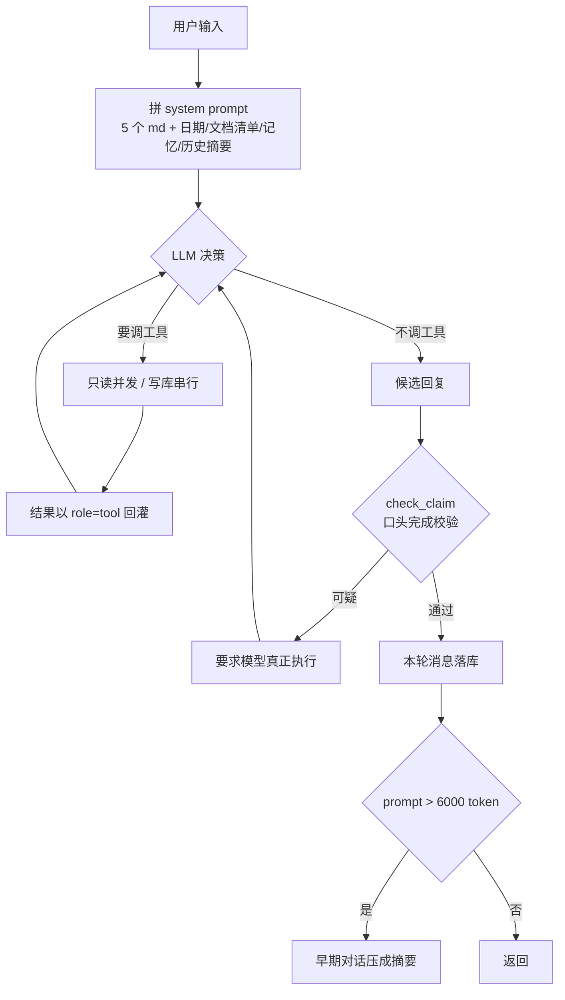

# agent-demo

从零手搓的命令行 Agent：工具调用 → RAG 检索 → 长期记忆 → 上下文压缩。
不套框架，每一步都自己实现，目的是把"LLM 应用里容易坏在哪"亲手踩一遍。

## 快速开始

```bash
uv sync
```

`.env`（项目根目录）：

```
DASHSCOPE_API_KEY=sk-xxx
OPENAI_BASE_URL=https://dashscope.aliyuncs.com/compatible-mode/v1
OPENAI_MODEL=qwen-plus
EMBED_MODEL=text-embedding-v3
```

运行：

```bash
uv run python agent.py          # 继续上次会话
uv run python agent.py --new    # 清空历史重开
```

回归测试：

```bash
uv run python tests/eval.py              # 21 条用例
uv run python tests/eval.py --only mem   # 只跑某一组
uv run python tests/eval.py -v           # FAIL 时打印完整回复
```

> 测试用 `data/eval.db`，与真实数据 `data/assistant.db` 完全隔离。**别删 eval.db**，删了向量索引要重建。

## 架构



## 目录

```
agent.py            主循环、工具调度、口头完成校验、上下文压缩
tools.py            工具实现 + SQLite 存储 + BM25/向量检索
rag.py              RAG 引擎（BM25 + 向量双路 + RRF 融合）
orchestrator.py     多 Agent 编排（B-1~B-6：handoff/规划/自评估/失败回溯/目标记忆/自驱）
server.py           FastAPI 服务 + SSE 流式接口 + MCP HTTP 挂载
mcp_server.py       MCP 服务（FastMCP，stdio + HTTP 传输）
tracing.py          链路追踪（span / trace_id）
prompts/
  01_persona.md     人设
  02_capability.md  能力边界与工具使用规则
  03_knowledge.md   RAG 检索与防幻觉规则
  04_memory.md      长期记忆
  05_history.md     对话历史与摘要
tests/
  eval.py           回归测试框架
  cases.jsonl       测试用例
documents/          知识库文档放这里（.md / .txt）
data/
  assistant.db      真实数据
  eval.db           测试数据
```

按文件名顺序拼接所有 `prompts/*.md`，注入四个占位符：`{date}` `{documents}` `{memories}` `{conversation_summary}`。

## 能力

| 工具 | 作用 |
|---|---|
| `get_weather` | 实时天气（Open-Meteo） |
| `add_todos` / `list_todos` / `complete_todo` / `delete_todo` | 待办增删改查 |
| `list_documents` / `read_document` | 读本地文档，长文档走分块摘要 |
| `search_knowledge` | BM25 + 向量双路检索，RRF 融合 |
| `remember` / `forget` | 长期记忆，跨会话 |
| `retrieve_history` | 从归档历史中检索相关片段（BM25 + 向量） |
| `create_goal` / `advance_goal` / `get_goal` / `update_goal_status` | 长期目标管理（跨对话推进） |

## 运行模式

| 模式 | 命令 | 说明 |
|------|------|------|
| CLI | `uv run python agent.py` | 命令行交互，退出时自动沉淀记忆 |
| Web 服务 | `uv run python server.py` | FastAPI + SSE，前端在 `http://localhost:8000` |
| MCP | `uv run python mcp_server.py` | stdio 模式，供 MCP 客户端调用 |
| MCP HTTP | 随 server.py 启动 | `POST /mcp/mcp`，streamable HTTP 传输 |

## 踩过的坑

这一节是这个项目真正值钱的部分。

1. **关键词检索的假阴性比假阳性更危险。** 「科研经费」里有「经费」命中了教育段落，让它以"唯一命中"的身份拿了第一 —— BM25 不会说"我不懂"，它给你一个看着相关、实则跑题的结果。
2. **检索查询 ≠ 用户原话。** 「全省科研经费是多少」整句向量化后，被"全省""是多少"稀释，语义路 Top-1 跑到社保基金去了。必须做查询改写（删疑问词，展开同义词）。
3. **检索对了，生成侧还能造个口径出来。** 数字全真、算式也对，但"科研经费"这个科目文档里根本不存在，是模型自己归类出来的。数字不假 ≠ 结论正确。
4. **提示词里一句轻率的断言，会成为模型编造的依据。** 写了"（摘要为空说明这是第一次对话）"，模型就据此编出"系统每次新会话从零开始"。
5. **校验逻辑是关键词方案，加工具必然回来维护词表。** `已为你保存` 同时撞上 `add_todos` 和 `remember`，把真实执行判定成撒谎。
6. **`exact match + 字面相似度` 拦不住事实更新。** 「我在杭州」→「我搬到北京了」字面无关但逻辑互斥，只能靠语义判定。
7. **修复手段本身会引入新 bug。** 加压缩时 `clear_session` 连刚写入的摘要一起删了 —— 得靠回归测试发现。
8. **相似度阈值对短文本必须按最坏情况校准。** `MEM_SIM_THRESHOLD=0.75` 在 6-10 字短句上够不到：「用户在杭州工作」→「用户在北京工作」ratio ≈ 0.714，被当成"两条不同记忆"普通新增而非归档。改成 0.65（依据：只改一个词的短句 ratio ≈ 0.71，真正无关的两句 ratio < 0.5）。教训：**相似度阈值要用最坏情况（只改一个词）校准，不能拍脑袋取整数。**
9. **确定性逻辑不该让 LLM 措辞当测试变量。** `mem-conflict` 用例走对话路径时，模型每轮措辞随机，相似度跟着抖，测试不稳。改用直调工具（`run_case` 加 `call` 步骤，不经 LLM、固定入参）测归档机制本身；LLM 路径只测"模型该不该调工具"。教训：**机制归机制测、措辞归措辞测，别让一个测试同时依赖两者。**
10. **循环导入的解法是延迟导入，不是赌 import 顺序。** `tools.py` 拆出 `rag.py` 后，顶部 `from rag import search_knowledge` 导致 `import rag` 优先时崩（partially initialized module）。改成懒加载包装函数 `_search_knowledge_lazy`，调用时才 `from rag import`，谁先 import 都能工作。教训：**跨模块循环依赖用函数内延迟导入，而不是调整文件内 import 顺序。**
11. **表结构迁移要顾及旧列的约束。** 给 `summaries` 表加 `fine_summary`/`coarse_summary` 时，旧 `summary` 列带 `NOT NULL`，新 INSERT 没给它赋值就报约束错误。SQLite 不支持删列，只能留着旧列并填空串占位。教训：**迁移时检查旧列约束，不能只加新列。**
12. **多租户隔离只在 SELECT 加过滤是不够的，查重和写入也要跟着隔离走。** 给 `memories` 加 `user_id` 后，只改 `list_memories` 的查询条件还不够——`remember` 的相似度查重仍然扫全表，导致李四记"上海"会把张三的"杭州"归档掉（相似度 ≥ 0.65 被当成同一件事的更新）。教训：**隔离的真正含义是"整个操作的作用域都缩到本租户"，从查重、写入到删除，每一条 SQL 都要带租户条件，不能只在最终展示时过滤。**
13. **相似度衡量"像不像"，衡量不了"冲不冲突"——阈值该当召回器，判定器得是理解者。** 记忆冲突判定第一版用"余弦 ≥ 0.82 就归档"，verify 实测打脸：互斥对（杭州→搬到北京）余弦 0.549，比无关对（杭州→喜欢吃辣）的 0.642 还低——整句向量反映主题接近度，无关的生活陈述底分 0.6+，换人称换句式的互斥陈述反而飘远，不存在能用的阈值。改成两级：≥ 0.82 直归档（省 LLM），0.45 ~ 0.82 交 LLM 判是否同一属性的新值。教训：**检索是召回问题，冲突判定是理解问题——阈值管召回、LLM 管判定，别拿相似度当法官。**

## 阶段进展

### 阶段 1：隐式记忆提取 ✅

**问题**：记忆只在用户嘴上说"记住…"时才写库（`remember` 工具）。真实对话里用户很少这样开口，"我是做后端的""我老家成都的"这类长期事实散落在闲聊里，没人喊"记住"就丢了。下一会话问"我是干啥的"，答不上来。

**方案**：用户退出会话时（`exit`/`quit`/`退出`），用一次纯 LLM 调用（不传 tools，避免递归）扫一遍当前上下文里的对话，按 `04_memory.md` 同一套"长期稳定/存疑不记"原则挑出值得跨会话保留的事实，逐条喂给现有 `remember` 写库——**复用既有去重/相似更新逻辑，不重写**。

- 触发点选"退出时"而非"每轮"：每轮跑太贵、污染主路径延迟；退出时跑对生产路径零侵入，且 `main()` 的退出分支测试不走，不破坏现有 21 条用例。
- 只看当前上下文窗口里的对话：已被压缩进摘要的旧事实扫不到——**这是已知盲点，留给阶段 3 解决**。
- 加了 `mem-impl` 用例：用户不喊"记住"，靠退出时 `extract:true` 兜底，最终只要记忆库出现"后端"就 PASS。

### 阶段 2：记忆冲突归档 ✅

**问题**：原 `remember` 相似度 ≥ 阈值就 `UPDATE` 旧行的 content，旧值永久消失。三个痛点：(1) "我在杭州→搬到北京"覆盖后，"之前在哪个城市"答不出；(2) 偶尔相似度失灵会矛盾并存；(3) 阶段性事实被无声丢弃。

**方案**：把"覆盖"改成"归档"——
- `memories` 表加 `valid_to`（失效时间，NULL=当前有效）+ `superseded_by`（被哪条 id 替代）两列；老库靠 `PRAGMA table_info` 检测后 `ALTER TABLE` 补列（沿用 chunks 表加 vec 列的套路）。
- 相似的旧值不删 content，只标 `valid_to` + `superseded_by`，新值作为新行插入。
- `list_memories`（注入 system prompt 用）只返回 `valid_to IS NULL` → 模型看到的永远是"当前真相"；旧值物理上还在表里 → "曾经"可查。
- `forget` 不用改：它删行，删当前有效行就是删当前有效，归档行留着无害。

**坑（第 8、9 条）**：阈值 0.75 在短句上够不到；用例经 LLM 措辞不稳。两个坑都在这一阶段踩出来并修掉了。

**故意留的盲点**：相似度算法仍是 `difflib.SequenceMatcher`（字面相似度），"我在杭州工作" vs "我搬到北京了"字面无关、ratio 可能 < 0.5，不走归档直接新增 → 又矛盾并存。彻底解决要换语义相似度（embedding），留到后面。

### 阶段 3：多级压缩 + 检索式历史召回 ✅

**问题**：原压缩是"一层摘要 + 删原文"。三个痛点：(1) 被压缩掉的早期对话原文物理删除，用户问"之前聊过什么"答不出；(2) 摘要越压越糙，"用户在杭州"这类核心事实被闲聊稀释；(3) 阶段 1 的 `extract_memories` 扫不到已压进摘要的旧事实。

**方案**：三件套——
- **归档不删除**：压缩时早期消息从 `messages` 挪到 `archived_messages`（含 BM25 倒排 + 向量索引），原文物理保留。
- **两级摘要**：`fine_summary`（近期要点，每次更新）+ `coarse_summary`（核心事实，细摘要超阈值时才沉淀进来）。核心事实进粗摘要后不受近期闲聊稀释。
- **检索式召回**：新增 `retrieve_history` 工具，复用 `search_knowledge` 的 BM25 + 向量 + RRF 双路架构，按用户问题从归档历史中召回相关片段。

**附带重构**：`tools.py`（1100→750 行）拆出 `rag.py`（RAG 引擎）。embedding 原语（`_embed`/`_tokenize`/`_cosine`）留在 tools.py，因为 `archive_messages` 也要用，放 rag.py 会循环依赖。

**坑（第 10、11 条）**：循环导入；旧列 NOT NULL 约束。

### 阶段 4：多会话 / 多用户隔离 ✅

**问题**：`todos` 和 `memories` 是全局表，没有归属概念。两个 bug：
- **数据泄露**：A 会话加的待办 B 会话看得到；张三的记忆会注入李四的 system prompt。
- **查重串味**（更隐蔽）：`remember` 的相似度查重扫的是全表。张三记"用户在杭州"，李四记"用户在上海"，相似度 ≥ 0.65 → 系统当成同一件事的更新 → 张三的记忆被李四覆盖。数据泄露只是"看见了不该看的"，查重串味是"改了不该改的"，更难察觉。

**方案**：按概念归属加两列——
- `todos` 加 `session_id`：待办属于这场对话（`messages`/`summaries` 早就按会话隔离，这里对齐同一个模型）。
- `memories` 加 `user_id`：记忆属于这个用户（跨会话的个人事实，跟会话走就丢了）。

**隔离机制设计**：
- 身份隐式注入，不暴露给模型：`_CURRENT_SESSION` / `_CURRENT_USER` 由 `agent.chat()` 每轮开头设置，工具签名里没有这两个参数 → 模型无法伪造租户身份。
- 过滤条件打到每一条语句：不只 SELECT 带 `WHERE session_id = ?`，INSERT 要写入、UPDATE/DELETE 也要带隔离条件 → 作用域焊死在 SQL 里，不寄希望于调用方记得过滤。
- 查重范围跟着隔离走：`remember` 的相似度查重从"全表"缩到"这个用户的记忆"——这是隔离的真正含义，光在显示时过滤不够。

**老库迁移**：`ALTER TABLE ... ADD COLUMN ... NOT NULL DEFAULT 'default'`——`DEFAULT` 兼做旧数据回填，老待办/老记忆自动归到 `default` 会话/用户名下，一个不丢。这是阶段 2 迁移套路的升级：当时要"补列 + UPDATE 回填"两步，现在靠 `DEFAULT` 一步到位。

**故意留的边界**：`main()` 写死 `user_id="default"`——阶段 4 的目标是"让系统具备隔离能力"，不是"做多用户登录界面"。真正的多用户接入（Web 服务从 session 取 user_id）接口已留好，`Agent(user_id=...)` 即插即用。

**坑（第 12 条）**：查重串味。

### 阶段 5：记忆查重语义化 ✅

**问题**：查重是字面相似度（坑 8 的 `SequenceMatcher`），「用户在杭州工作」→「我搬到北京了」ratio < 0.5 阈值拦不住，矛盾两条并存。已知限制里标粗"只能缓解、不能根治"的那条。

**弯路（比方案值钱）**：第一版做"字面 + 余弦双路，≥ 0.82 归档"。verify 实测当场证伪：互斥对余弦只有 **0.549**，比无关对（杭州→喜欢吃辣）的 **0.642** 还低——整句向量衡量主题接近度，无关的生活陈述同属一个语义区域底分 0.6+，换人称换句式的互斥陈述反而飘远。**不存在任何阈值能同时拦住互斥、放过无关。**

**最终方案**：阈值降级为召回器，LLM 升级为判定器——
- `memories` 加 `vec` 列（PRAGMA 补列），写入时算向量入库，老数据遇查重时懒补算自愈（`_row_vec`）
- 高置信：`ratio ≥ 0.65 或 cos ≥ 0.82` → 直接归档，零 LLM 成本
- 中置信：`0.45 ≤ cos < 0.82` → 一次 LLM 判定（temperature=0、强制 JSON、失败降级）：是否同一属性的新值？是则归档
- 低置信 / embedding 熔断 / LLM 失败 → 普通新增，`remember` 永远可用

**关键转变**：阈值错了只影响成本（多一次 LLM 调用），不再影响正确性——正确性移交给真正懂"矛盾"的判定者。与阶段 1 退出提取同款成本模式：写路径加 LLM 调用。

**坑（第 13 条）**：相似度判不了冲突。

### 阶段 6：服务化（FastAPI + SSE + MCP） ✅

**问题**：agent 只能在 CLI 里跑，没法接前端、没法被其他系统调用。

**方案**：
- **SSE 流式接口**：`POST /chat/stream`，把 `chat_stream` 的事件（text / tool_result / claim_warning / final）通过 Server-Sent Events 推给前端。前端 `fetch` + `ReadableStream` 逐帧解析。
- **MCP 服务**：用 `FastMCP` 把同一套工具暴露成 MCP 协议，支持两种传输：
  - stdio：`python mcp_server.py`，供 Claude Desktop 等 MCP 客户端调用
  - HTTP：挂载在 `/mcp`，供远程 MCP 客户端调用
- **传输独立性验证**：同一套工具逻辑，CLI / SSE / MCP stdio / MCP HTTP 四条路径都能跑，验证"工具实现与传输层解耦"。
- **链路追踪**：`tracing.py` 给每轮对话生成 trace_id，记录每个 span（LLM 调用、工具执行），`/traces/{trace_id}` 可查。

**坑**：FastMCP 的 `streamable_http_app()` 作为子应用挂载时，自带的 lifespan 不会被 Starlette 触发（只跑顶层 lifespan），导致 session manager 不启动、MCP 调用挂死。解法：在顶层 `lifespan` 里手动 `async with mcp.session_manager.run()` 接管生命周期。

### 阶段 7：多 Agent 编排（B-1 ~ B-6） ✅

从单 Agent 升级到 Supervisor-Worker 架构，逐步逼近 L4 自主 Agent。每个 B 阶段对应一个核心能力。

#### B-1：Handoff 分工 ✅

**核心**：Supervisor 不直接调业务工具，只调 `handoff_to_weather` / `handoff_to_todo` 把子任务派给专精 Worker。Worker 只看自己领域的工具（物理隔离角色边界）。

```
用户 → Supervisor → handoff_to_weather → Weather Worker → get_weather
                → handoff_to_todo    → Todo Worker    → add_todos 等
```

#### B-2：显式规划 ✅

**核心**：计划不再是模型脑子里的临时想法，而是可观察的 `PlanState` 对象。Supervisor 先 `make_plan(steps)` 拆步骤，再按 `step_idx` 逐个 handoff 执行，执行后自动 `mark_done`。

#### B-3：自我评估 ✅

**核心**：每步执行后必须调 `evaluate_step(step_idx, pass/needs_retry)`。needs_retry 会重做（有上限），全部 done 后调 `evaluate_task` 整体评估。评估和执行是两个独立动作，不能合并。

#### B-4：失败回溯 ✅

**核心**：执行中发现计划不合适，可以调 `update_plan` 动态改计划（insert/delete/replace）。某步 failed 后必须调 `decide_after_failure` 显式选择 abort/skip/revise，不能沉默继续。

#### B-5：长期目标记忆 ✅

**核心**：引入 `goals` 表，比 todos 高一级：
- todos = 单步动作（今天读 50 页）
- goals = 跨多次对话推进的成果（这周读完《活着》）

Supervisor 启动时注入进行中目标，有 `create_goal` / `advance_goal` / `get_goal` / `update_goal_status` 四个工具。`next_step` 字段是给"未来的自己"的提示，让目标能跨对话接续推进。

#### B-6：自驱循环 ✅

**核心**：从"反应式"（用户发消息才干）升级到"主动式"（没人发消息也能自己推进目标）。

- **调度器**：daemon 线程每 300 秒遍历注册目标，调 `run_proactive_round`
- **触发消息**：把各目标的 `next_step` 拼成系统提示，作为"无用户输入"的一轮对话
- **防空转**：只有"实质推进"（加待办/查天气/记进度）才执行，检查/等待一律跳过，不刷垃圾日志
- **防伪造**：需要用户反馈的目标一律跳过，绝不编造用户回复
- **防日期幻觉**：触发消息注入真实日期锚点，禁止模型自行推断时间流逝

**自驱能干啥**：严格按照 `next_step` 里写清楚的、它能力范围内的动作执行（如"加一条待办"）。不能做需要用户输入或决策的事。

**部署说明**：当前 demo 跑在本地进程，关电脑就停。要让它"你不在时也干活"，需部署到不关机的服务器（云主机 + systemd/Docker 常驻）。

## 已知限制

- 记忆的数量/ embedding 都是 CPU 暴力算，几千个 chunk 够用，上万要换方案
- 文档增删后靠 mtime 重建索引，没有增量更新
- 「口头完成」校验基于字符串匹配，只能覆盖已知说法
- **归档历史检索只覆盖当前会话**：`retrieve_history` 按 `session_id` 过滤，跨会话的历史查不到
- **多用户隔离仅在数据层**：`main()` 仍写死单用户，没有登录/鉴权；隔离能力已就绪但未接真实用户体系
- **记忆查重不再是纯本地**：中段候选会触发一次 LLM 冲突判定调用，`remember` 的延迟和成本略有上升
- **自驱循环仅本地单线程**：调度器是 daemon 线程，关进程即停；多用户并发或高可用需换 APScheduler + Redis 锁 / Celery beat
- **Worker 能力固定**：当前只有 weather / todo 两个 Worker，新增领域需手动加 Worker 类和 handoff 工具

## 下一步

- [x] ~~记忆冲突消解：让一条事实支持多个版本并带时间戳~~（阶段 2 已做）
- [x] ~~隐式记忆提取：退出时用 LLM 扫一遍对话自动沉淀~~（阶段 1 已做）
- [x] ~~对话历史的多轮压缩与检索~~（阶段 3 已做：归档 + 两级摘要 + `retrieve_history`）
- [x] ~~多会话/多用户隔离~~（阶段 4 已做：todos 按 session、memories 按 user 隔离）
- [x] ~~记忆相似度升级为语义匹配（embedding）~~（阶段 5 已做：双路召回 + LLM 冲突判定）
- [x] ~~服务化：FastAPI + SSE + MCP~~（阶段 6 已做）
- [x] ~~多 Agent 编排：B-1 handoff → B-2 规划 → B-3 自评估 → B-4 失败回溯 → B-5 目标记忆 → B-6 自驱循环~~（阶段 7 已做）
- [ ] 接入真实用户体系（登录 / 鉴权 / user_id 从 session 读取）
- [ ] 跨会话历史检索（`retrieve_history` 放宽到本用户全部会话）
- [ ] 自驱调度器生产化（APScheduler / Celery beat + 分布式锁）
- [ ] 动态 Worker 注册（新增领域 Worker 不需改 orchestrator 代码）
